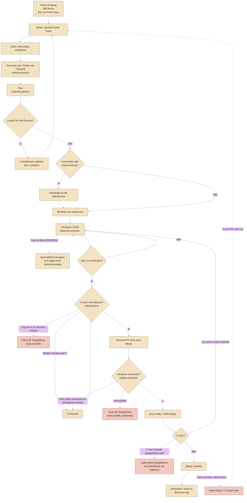
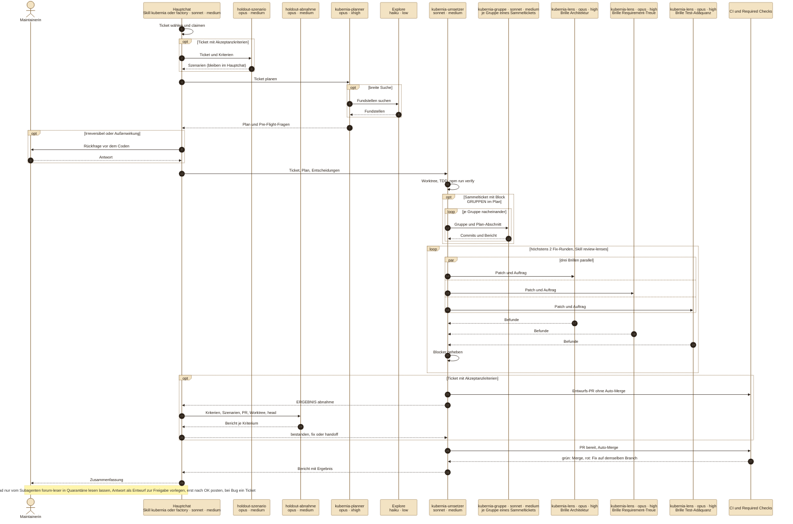
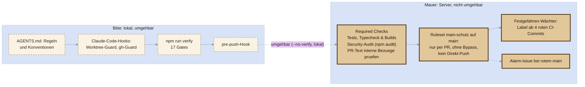

# Der KI-Agenten-Harness von Kubernia — wie + warum

> **Projektanteil.** Das erklärende Gesamtbild des Harness (Kernidee, Bausteine, Gates, Schleife) steht im Factory-Repo: [Der KI-Agenten-Harness](https://github.com/fluffels/self-improving-agent-harness-and-factory/blob/v0.2.0/docs/agent-harness.md). Hier bleiben die generierten Abschnitte und das, was nur dieses Projekt betrifft.
>
> Welche Seite Projekt und welche Kern ist: [Inventar](referenz/anlaufstellen.md#factory-seiten-projektanteil-und-kern). Begriffe: [Harness-Glossar](harness-glossar.md).

## 1. Die Kernidee

Kern: [1. Die Kernidee](https://github.com/fluffels/self-improving-agent-harness-and-factory/blob/v0.2.0/docs/agent-harness.md#1-die-kernidee)

<!-- factory-projekt:start -->

**Der Harness in Zahlen** (aus dem Repo gezählt; ein zusätzliches Skript, ein Wächter-Test, ein CI-Workflow oder ein ADR macht den Abschnitt veraltet, bis `npm run docs:gen` läuft, [ADR 0017](adr/0017-lebende-doku-generierte-abschnitte.md)):

<!-- factory-projekt:ende -->

<!-- GEN:harness-kennzahlen START -->
<!-- Generiert von npm run docs:gen – nicht von Hand ändern. -->

| Kennzahl | Wert | Zählregel |
|---|---|---|
| Prüfschritte in `verify` | 17 | eigene Schritte der Kette `verify` in package.json, verschachtelte Ketten aufgelöst, je Schritt einmal |
| Prüfschritte in `verify:full` | 6 | eigene Schritte der Kette `verify:full` in package.json, verschachtelte Ketten aufgelöst, je Schritt einmal |
| Skripte | ≥ 150 | Dateien `.mjs`/`.cjs` unter `scripts/` (rekursiv), ab 10 auf Zehner abgerundet |
| Wächter-Tests | ≥ 40 | `*.test.ts` unter `test/harness/` (rekursiv) mit dem Marker `@harness-waechter` im Kopf, ab 10 auf Zehner abgerundet |
| CI-Workflows | 15 | `*.yml`/`*.yaml` direkt unter `.github/workflows/` |
| ADRs | 29 | `NNNN-*.md` unter `docs/adr/` (ohne `README.md`), nach `adr-liste` |

<!-- GEN:harness-kennzahlen END -->

## 2. Die fünf Bausteine

Kern: [2. Die fünf Bausteine](https://github.com/fluffels/self-improving-agent-harness-and-factory/blob/v0.2.0/docs/agent-harness.md#2-die-fünf-bausteine)

### 2.3 Kollisionsschutz für parallele Agenten

Kern: [2.3 Kollisionsschutz für parallele Agenten](https://github.com/fluffels/self-improving-agent-harness-and-factory/blob/v0.2.0/docs/agent-harness.md#23-kollisionsschutz-für-parallele-agenten)

### 2.5 Skills + Setup als reproduzierbare Abläufe

Kern: [2.5 Skills + Setup als reproduzierbare Abläufe](https://github.com/fluffels/self-improving-agent-harness-and-factory/blob/v0.2.0/docs/agent-harness.md#25-skills--setup-als-reproduzierbare-abläufe)

## 3. Die Fitness-Functions im Detail

Kern: [3. Die Fitness-Functions im Detail](https://github.com/fluffels/self-improving-agent-harness-and-factory/blob/v0.2.0/docs/agent-harness.md#3-die-fitness-functions-im-detail)

<!-- GEN:gates START -->
<!-- Generiert von npm run docs:gen – nicht von Hand ändern. -->

| Gate | Kette | Was es sichert |
|---|---|---|
| `npm run typecheck` | `verify` | voll `strict`, ganzes Projekt |
| `npm run lint` | `verify` | ESLint typbewusst, `--max-warnings 0`, `any` blockt, Komplexität je Funktion |
| `npm run check:arch` | `verify` | Schichtung, keine Zyklen, kein toter Code (dependency-cruiser) |
| `npm run check:size` | `verify` | God-File-Frühwarnung (Zeilen-Budget je Modul) |
| `npm run check:contextsize` | `verify` | Größenbudget jeder AGENTS.md (Zeichen) |
| `npm run check:anysuppress` | `verify` | Ratchet auf die Zahl begründeter `any`-Ausnahmen |
| `npm run check:docmap` | `verify` | jede `src/`-Datei ist in einem Tiefendoc erwähnt, die Landkarte kann nicht leise veralten |
| `npm run check:docdrift` | `verify` | dokumentierte `npm run`-Kommandos, interne Doku-Links und Anker, verify-Ketten-Kopien |
| `npm run check:factorylinks` | `verify` | Links ins Factory-Repo stehen auf dem Sync-Tag und treffen Pfad und Anker laut Index `.factory/factory-links.json` |
| `npm run check:docgen` | `verify` | generierte Doku-Abschnitte (`GEN:`-Marker) stimmen mit dem Repo überein |
| `npm run check:c4` | `verify` | LikeC4-Modell: validiert, formatiert; Schichten, Phaser, Schicht-Kanten und Top-Level-Module stimmen mit `scripts/layers.cjs` und `src/` überein, die hexagonale Sicht in arc42 (Ports und Adapter) mit Pfaden, Schichten und Modell, die Harness-Arten (Agenten, Skills, Workflows, Hooks, Git-Hooks, Gates, CI-Workflows, MCP-Server) mit `.claude/`, `package.json`, `.githooks/`, `.github/workflows/` und `.mcp.json`, die Pflicht-Views |
| `npm run check:internalrefs` | `verify` | keine internen Bezüge im öffentlichen Repo |
| `npm run check:factorydrift` | `verify` | Factory-Besitz (`.factory/besitz.json`) stimmt mit dem Sync-Stand überein, ein Projekt ändert ihn nicht still (die Besitz-Prüfung entfällt ohne Sync-Stand; die Projektwert-Stellen prüft es immer gegen die Config) |
| `npm run check:steuerbytes` | `verify` | keine Steuerbytes (NUL) in Textdateien |
| `npm run check:lockfile` | `verify` | Lockfile passt zur `package.json` |
| `npm run check:diffsize` | `verify` | Slice-Größe (Dateien und Zeilen gegen die Merge-Base) |
| `npm test` | `verify` | Verhalten von Domäne, Sim, Wirtschaft und Harness-Wächtern, inkl. Negativ- und Grenzfälle (Vitest) |
| `npm run test:coverage` | `verify:full` | Coverage-Floors je Schicht-Bucket |
| `npm run check:diffcoverage` | `verify:full` | Abdeckung der im Slice geänderten Zeilen |
| `npm run build` | `verify:full` | Host-Build (`dist/`) baut fehlerfrei |
| `npm run build:offline` | `verify:full` | Offline-Einzeldatei (`dist-offline/index.html`) baut fehlerfrei |
| `npm run check:bundle` | `verify:full` | Byte-Budget je Chunk-Art: Offline-HTML, Spielcode, Content-Chunks (je Datei), Phaser-Chunk |
| `npm run test:smoke` | `verify:full` | Boot- und Interaktions-Smokes headless gegen Offline- und Host-Build (Playwright) |
| `npm audit --omit=dev --audit-level=high` | CI | Security-Gate über die ausgelieferten Produktiv-Abhängigkeiten |
| `node scripts/check-review-nachweis.mjs` | CI | Review-Nachweis (`KQ-Plan:`/`KQ-Review:`) im PR |
| `node scripts/check-abnahme-nachweis.mjs` | CI | Abnahme-Nachweis (`KQ-Abnahme:` plus PR-Kommentar) im PR |
| `npm run sbom` | CI | CycloneDX-SBOM der npm-Abhängigkeiten (aus dem Lockfile) als CI-Artefakt; rot, wenn Erzeugung oder Artefakt fehlt |

<!-- GEN:gates END -->

<!-- factory-projekt:start -->

### Architektur-Wächter (`npm run check:arch`, dependency-cruiser, #347/#390)
- **WAS:** die Schichtung (pure Domäne ↔ Anwendung ↔ Präsentation) — Domäne und Anwendung importieren **nur die Domäne** (kein `phaser`, keine `scenes`/`ui`/`sfx`, kein Einstieg); die Richtungen stehen als Positivliste in `SCHICHT_MODELL` (`scripts/layers.cjs`). Zusätzlich verboten: **Import-Zyklen** und **verwaiste Module** (toter Code), Typ-Importe zählen mit.
- **WARUM:** die Schichtgrenze ist das, was die Domäne testbar hält (§2.1 Testbarkeit). Der Befund #292 (`game.ts → sfx.ts` hatte sich unbemerkt eingeschlichen) zeigte: Review-Disziplin allein hält die Grenze nicht — sie muss **erzwungen** sein.
- **Kein Grün-durch-Aufweichen:** einen Zyklus löst man auf (geteilten Zustand nach `runtime.ts`/`sim/state.ts` ziehen), toten Code löscht man, eine Ausnahme kommt nur mit offenem Split-Ticket + Begründung in die `pathNot`-Allowlist.

<!-- factory-projekt:ende -->

### Lebende-Doku-Wächter (`npm run check:docgen`, #1355)

Kern: [Lebende-Doku-Wächter (`npm run check:docgen`, #1355)](https://github.com/fluffels/self-improving-agent-harness-and-factory/blob/v0.2.0/docs/agent-harness.md#lebende-doku-wächter-npm-run-checkdocgen-1355)

<!-- factory-projekt:start -->

- **Spiel-Generatoren (#1370, über `generatoren` der Config eingebunden, ADR 0022 F6):** `save-versionen` ist rot bei einer Migration ohne Beschreibung in `src/store/save-versionen.json` (und bei einer Beschreibung ohne Migration), `quest-graph` und `quests-je-thema` bei einer Quest, die in `quest-order.json` fehlt, einem Geber ohne Standplatz oder einem unbekannten `requires`/Thema; ein Content-Ticket läuft danach `npm run docs:gen`.

<!-- factory-projekt:ende -->

<!-- factory-projekt:start -->

### Architekturmodell-Wächter (`npm run check:c4`, #1420)
- **WAS:** das LikeC4-Modell unter [`docs/architektur/`](architektur/spiel.c4) (Element-Arten in `spezifikation.c4`, Spiel-Views in `spiel.c4`, Harness-Sichten in [`harness.c4`](architektur/harness.c4)) ist rot, wenn `likec4 validate` oder `likec4 format --check` scheitern (Fix: `npm run c4:format`) oder der Abgleich in `scripts/check-c4.mjs` etwas findet. Gebunden wird über **Art + Titel**: `schicht` und `bibliothek` gegen die Labels von `SCHICHT_MODELL` in `scripts/layers.cjs`, Beziehungen zwischen ihnen gegen `sollKanten` (rot in beide Richtungen: verbotene und fehlende), `modul` gegen die Top-Level-Einträge von `src/` (Ordner plus `.ts` ohne gleichnamigen Ordner, ohne `.d.ts`) unter der Schicht, die `schichtVon` liefert. Eine Beziehung mit Modul-Ende ist rot (nicht ableitbar), eine Art ohne Bindung und ohne Eintrag in `erzaehlung` ebenso (fail-closed), ein doppelter Titel in einer gebundenen Art ebenso, eine View über `architektur.maxKnotenJeView` Knoten (nur senken) ebenso. Pfade und Bindungen stehen im Block `architektur` von `scripts/docs-gen/config.json`. Jede Meldung nennt Datei:Zeile, Element und Fix; „fehlt im Modell“ nennt die Datei der Elemente derselben Familie (sonst den Workspace), Texte nennen die Schicht-Quelle aus `schichten.layers`. Ansehen: `npm run c4:serve`.
- **Harness-Bindungen (`scripts/check-c4-harness.mjs`, rot je in beide Richtungen):** `agent`, `skill` und `workflow` gegen den `harnessKatalog` (`scripts/docs-gen/harness-inventar.mjs`, Titel = Name aus dem Frontmatter bzw. `meta.name`), `hook` gegen die Event-Namen unter `hooks` in `.claude/settings.json`, `githook` gegen `.githooks/*`, `gate` gegen die Blätter von `verify` und `verify:full` (`kettenSchritte`, `scripts/docs-gen/npm-ketten.mjs`; ein Gate liegt unter dem Element, dessen Titel seine Kette ist, `verify` bzw. `verify:full`), `ciworkflow` gegen `.github/workflows/*.yml` und `*.yaml`, `mcp` gegen die Schlüssel in `.mcp.json`. Eine gebundene Art ohne Quelle (Pfad nicht konfiguriert) ist rot, ein konfigurierter, aber fehlender Pfad lässt den Wächter mit dem Dateinamen scheitern. Beziehungen zwischen Harness-Elementen sind Erzählung und werden nicht geprüft.
- **Pflicht-Views und Ziffern-Regel:** `architektur.pflichtViews` (nicht-leere Liste, die Config führt `ticket-lauf`; das Streichen eines Eintrags ist ein reviewter Config-Diff auf einem Leitplanken-Pfad) nennt Views, die im Modell stehen müssen; fehlt eine, ist das rot. Eine freistehende Zahl (Ziffer ohne Buchstaben oder Ziffer davor) in Beschreibung, Technik, Beziehungs- und Schritt-Labels, View-Titeln und Titeln nicht gebundener Arten ist rot, damit Zahlen aus SSOT-Konstanten (Lens-Cap, Fix-Versuche, Gate-Zahl) nie als ungeprüfte Kopie in `.c4`-Labels stehen; sie gehören den generierten Diagrammen (`docs:gen`). Zahlwörter erkennt die Regel nicht (Review-Sache).
- **WARUM:** das Modell ist eine zweite Ableitung derselben SSOTs wie die generierten Schichtdiagramme ([ADR 0020](adr/0020-architekturmodell-likec4.md)). Ein handgeschriebenes Modell ohne Abgleich würde still driften; ein neuer Top-Level-Ordner in `src/` macht `check:c4` rot, bis das Modul im Modell steht. Die Hexagon-Bindung ([ADR 0024](adr/0024-hexagon-als-lesart.md)) prüft die Tabellen `Port` und `Adapter` im arc42-Abschnitt „Hexagonale Sicht“: jeder Backtick-Pfad des Abschnitts unter `src/`, `test/`, `scripts/` und `docs/` existiert, die Schicht-Spalte stimmt mit `scripts/layers.cjs` überein, und das Modell hat dieselben Elemente der Arten `port` und `adapter` (Tag `treibend` bzw. `getrieben`, Kante Adapter → Port). Eine View, die eine abgeleitete Kante mit Modul-Ende zeigt, ist rot (die Hexagon-Kanten tragen `#hexagon` und werden per `exclude * -> * where tag is #hexagon` aus den Modul-Views genommen).
- **Absicherung:** `test/check-c4.test.ts` und `test/check-c4-harness.test.ts` (Fixture-Root, Red-Green je Regel, je Harness-Art beide Richtungen; der Adapter `ladeC4Modell`, der einzige Zugriff auf die LikeC4-Model-API, läuft gegen einen gültigen und einen kaputten Fixture-Workspace). `likec4` ist exakt gepinnt (`1.59.4`), weil sich der Formatter zwischen Minor-Versionen ändern kann; ein Bump macht `check:c4` ggf. rot, Fix `npm run c4:format`. Skript und Config sind Leitplanken-Pfade.

<!-- factory-projekt:ende -->

<!-- factory-projekt:start -->

### Factory-Link-Wächter (`npm run check:factorylinks`, #1966)
- **WAS:** `scripts/check-factory-links.mjs` prüft die Links ins Factory-Repo (`https://github.com/<repo>/(blob|tree)/<ref>/<pfad>[#anker]`, Repo aus dem Board mit Rolle `factory` in `.factory/projekt.json`) hermetisch gegen den Index `.factory/factory-links.json` (`repo`, `tag`, `commit`, `ziele: {pfad: [anker, "" = Seite]}`): Index-Tag und -Commit gleich `sync-stand.json` › `quelle`, jeder Link im Umfang nennt den Sync-Tag als Ref, jedes Paar (Pfad, Anker) steht im Index, ein Eintrag ohne Link ist rot. `npm run check:factorylinks -- --schreiben --quelle <klon>` liest den Tag per `leserVomCommit`, prüft, dass er auf `quelle.commit` zeigt, sowie Pfad (`tree/` als Ordner-Präfix) und Anker (nur bei `blob` auf `*.md`, GitHub-Slugs) und schreibt nur ohne Befund Refs und Index, sonst nichts. Der Scan-Umfang steht als geschlossene Liste im Kopfkommentar des Skripts (Ausnahmen: ADRs, Lessons Learned, Gegenproben, Schnappschuss-Blöcke, Besitz-Einheiten).
- **WARUM:** nach der Kürzung tragen Links ins Factory-Repo das Kernwissen; `check:docdrift` überspringt externe Links. Ohne Tag-Kopplung zeigten sie auf einen beweglichen oder veralteten Stand. Ein Sync auf einen neuen Tag macht `verify` bewusst rot, bis `--schreiben` lief (die Meldung nennt den Befehl).
- **Absicherung:** [`factory-links-projekt.test.ts`](../test/harness/factory-links-projekt.test.ts) (Scanner, Umfang, jeder Negativfall, Schreibmodus gegen ein temporäres Git-Repo mit Tag als Quelle, Lebendigkeit an der echten Doku). **Projekt-Gate, kein Besitz:** das Skript ist generisch geschnitten (Projektwerte nur im Block `PROJEKTWERTE`) und zieht später ins Factory-Repo; Entscheidungen und Grenzen: [Fortschreibung #1966](adr/fortschreibungen/0022-1966-factory-links.md). Skript und Index sind Leitplanken-Pfade.

<!-- factory-projekt:ende -->

### Selbstbeschreibungs-Wächter (`test/harness/selbstbeschreibung.test.ts`, #1714)

Kern: [Selbstbeschreibungs-Wächter (`test/harness/selbstbeschreibung.test.ts`, #1714)](https://github.com/fluffels/self-improving-agent-harness-and-factory/blob/v0.2.0/docs/agent-harness.md#selbstbeschreibungs-wächter-testharnessselbstbeschreibungtestts-1714)

<!-- factory-projekt:start -->

### Boot-/Interaktions-Smokes (`npm run smoke`, Playwright, #391/#480)
- **WAS:** lädt den **gebauten Offline-Build** (`dist-offline/index.html` per `file://`, genau der Doppelklick-Pfad) headless in Chromium; ein eigener Host-Boot-Smoke (`e2e/host-boot-smoke.spec.ts`, #1408) startet den **Host-Build** (`dist/`) über Vites `preview` und prüft zusätzlich, dass die Content-Chunks unter `assets/content/` mit 200 ausgeliefert werden (beide Builds müssen vorliegen, `npm run smoke` baut sie). Boot-Smoke: fährt fehlerfrei hoch (Boot-Flag, Canvas da, keine Konsolen-/Laufzeitfehler). Interaktions-Smokes: `help` ins Terminal → Ausgabe, Overlay auf/zu, Onboarding-Quest annehmen + abschließen — über Tastatur/DOM ohne Test-Hintertür.
- **WARUM:** die Vitest-Unit-Tests fassen die Präsentation (Engine/DOM) bewusst **nicht** an. Ein Fehler, der erst beim echten Boot auftritt (Phaser-Init, ein werfender Content-Loader, ein kaputtes Asset-Manifest) oder eine Interaktions-Regression (Terminal nimmt keine Eingabe) käme sonst durch.
- **Absicherung:** bewusst **schlank** (kein NPC-Nähe-Overlay, keine Weltbewegung), um flake-frei zu bleiben; Red-Green über sabotierte Tastenkopplung nachgewiesen. Getrennt von Vitest (`test/**` vs. `e2e/**`), damit sich die Test-Welten nicht überschneiden.

<!-- factory-projekt:ende -->

<!-- factory-projekt:start -->

### Deploy-Validierung (`deploy/**`, #1544)
- **WAS:** [`deploy-validate.yml`](../.github/workflows/deploy-validate.yml) läuft bei Änderungen an `deploy/**`: `helm lint --strict` (Default und `deploy/chart/ci/*-values.yaml`) plus kubeconform über die rohen Manifeste und das gerenderte Chart, gegen Kubernetes-, cert-manager- und Gateway-API-Schemas. Eingaben fest: kubeconform-Version mit SHA256, Kubernetes-Version, Commit des CRD-Katalogs (Handanhebung, kein Dependabot); nicht fest sind das Helm-Binary des Runners und die Basis-Schemas (`default`, nur der Versionsordner ist gepinnt). Ein Wächter ([`deploy-validate.test.ts`](../test/harness/deploy-validate.test.ts)) hält `shell: bash`, `--strict`, fail-closed und das Fehlen von `continue-on-error`.
- **Absicherung:** **nicht-blockierend**, kein Required Check, aber ohne `continue-on-error` (der Lauf ist deterministisch, ein verstecktes Rot wäre kein Signal). Ein fehlendes Schema ist ein Fehler (kein `-ignore-missing-schemas`). `defaults.run.shell: bash` ist tragend: nur so bricht `helm template | kubeconform -` bei einem helm-Fehler ab. Der Workflow zählt nicht im `festgefahren`-Zähler (der hört nur auf „CI“). Eine Hochstufung zum Required Check ist eine Ruleset-Änderung (vorher klären, `paths:` dann durch einen job-internen Skip ersetzen).
- **Grenze:** kubeconform prüft Schemas, keine Semantik (ein unbekannter `pathType`-Wert geht durch); Verweise in der Doku auf archivierte Upstream-Repos findet der Job nicht.

<!-- factory-projekt:ende -->

### Projekt-Gates der Langfassung (Schichtung, Bundle, Duplikation)

<!-- factory-projekt:start -->

- **Schichtung wird automatisch bewacht.** Die Schichtungsregeln (siehe [AGENTS.md › Architektur](../AGENTS.md#architektur): pure Domäne ↔ Anwendung ↔ Präsentation, Phaser-Grenze) werden von `dependency-cruiser` erzwungen, nicht nur per Review-Disziplin gehalten: `npm run check:arch` (`.dependency-cruiser.cjs`) schlägt fehl, wenn z.B. die Domäne/Anwendung `phaser` oder `scenes`/`ui`/`sfx` importiert. Läuft in der CI als Gate (nach dem Typecheck) und muss grün bleiben – verschiebst du Module zwischen Schichten, den Check lokal laufen lassen.
- **Zyklen, verwaiste Module & Dateigröße werden automatisch bewacht.** `check:arch` verbietet zusätzlich **Import-Zyklen** (`keine-zyklen`) und **verwaiste Module** (`keine-verwaisten-module`, toter Code) – Typ-Importe zählen dabei mit (`tsPreCompilationDeps`). Separat meldet `npm run check:size` (`scripts/check-size.mjs`) jedes `src`-Modul über dem **Zeilen-Budget (800 LOC)** als God-File-Frühwarnung – dieselbe Logik testet [`filesize.test.ts`](https://github.com/fluffels/self-improving-agent-harness-and-factory/blob/v0.2.0/test/filesize.test.ts) (also auch im `npm test`-Gate). Beide laufen in der CI. **Kein Grün-durch-Aufweichen:** einen Zyklus auflösen (geteilten Zustand nach `runtime.ts`/`sim/state.ts` ziehen, wie bei #390 für `ExecResult` gemacht), toten Code löschen, ein zu großes Modul aufteilen – eine Ausnahme nur mit offenem Split-Ticket als Eintrag unter `ausnahmen.groesse` (`.factory/projekt.json`) bzw. `pathNot` (`.dependency-cruiser.cjs`), mit Begründung. Fällt eine allowlistete Datei wieder unter Budget, meldet der Wächter den Eintrag als stale.

<!-- factory-projekt:ende -->

<!-- factory-projekt:start -->

- **Die Größe der AUSGELIEFERTEN Bundles wird bewacht.** Neben dem Zeilen-Budget je Modul (`check:size`) und dem Diff-Budget je Slice (`check:diffsize`) gibt es ein **Byte-Budget** für das, was der Nutzer wirklich lädt: `npm run check:bundle` (`scripts/check-bundle.mjs`) misst **`dist-offline/index.html`** (die self-contained Offline-Datei — inlined via `vite-plugin-singlefile` ALLE Assets als base64, wächst bei jedem neuen PixelLab-Asset unbemerkt; gemessen wird sie abzüglich der Summe der Content-Chunks, die dort inline stecken; dafür müssen `dist/` und `dist-offline/` vom selben Content-Stand sein, darum tragen beide `index.html` den Hash der Content-Quellen als Meta-Tag `kq-content-stempel` (Plugin in `vite.config.ts`) und das Gate wird bei verschiedenen oder fehlenden Stempeln rot), den **Spielcode in `dist/`** (alle JS-Chunks direkt in `dist/assets/` OHNE den langlebigen Phaser-`vendor`-Chunk #199 und OHNE die Content-Chunks — das Budget bleibt so auf UNSEREM Code), die **Content-Chunks** in `dist/assets/content/` (#1408, [ADR 0018](adr/0018-content-chunks-je-datei.md): je Datei unter `src/content/data/` und je Karte ein Chunk; die erwartete Menge leitet `scripts/content-chunks.cjs` aus den Quellen ab, ein fehlender oder unerwarteter Chunk, ein Chunk über dem Deckel je Datei und eine Summe über dem Stufe-2-Auslöser sind rot; Deckel und Auslöser werden nicht angehoben, sondern die Datei gesplittet bzw. Lazy-Load je Region gebaut) und den **Phaser-`vendor`-Chunk** selbst als eigenes hartes Byte-Gate (#595; ein Phaser-Bump fiele sonst nur indirekt übers Offline-HTML-Budget auf) und wird **rot**, sobald ein Artefakt sein Byte-Budget überschreitet. Zweck: `vite.config.ts` setzt nur `chunkSizeWarningLimit` (eine Log-**Warnung**, kein Fail) — dieser Wächter macht daraus ein echtes Gate. **Läuft bewusst NUR, wo die Builds vorliegen:** als CI-Schritt **nach** den Builds und in `npm run verify:full` (nach `build`+`build:offline`), **nicht** in der schnellen build-freien `npm run verify`-Kette. Fehlt ein Artefakt, wird der Wächter **rot** (mit „erst bauen"-Hinweis) statt still grün — ein Gate, das nichts gemessen hat, darf nicht grün melden. **Kein Grün-durch-Aufweichen (gleiche Philosophie wie `check:size`):** ein zu kleines Budget wird nicht stillschweigend erhöht — die Konstante in `BUNDLE_BUDGETS` wird per reviewtem Commit mit Ein-Zeilen-Begründung angehoben (Ratchet nach oben, wenn eine bewusste Ergänzung das Bundle legitim wachsen lässt), nie von der Maschine. Dieselbe Logik testet `test/bundle.test.ts` (mit injizierter IO, ohne echten Build).

<!-- factory-projekt:ende -->

<!-- factory-projekt:start -->

- **Copy-Paste wird berichtet, nicht gegatet.** `npm run check:duplication` (jscpd über `src`, Config `.jscpd.json`) macht wiedereingeführtes Copy-Paste sichtbar — die SSOT-Umgehungen (#534/#577/#578, `_resetNodes`/#596) waren die einzige Regressionsklasse ohne direkten Guard (nur Invariant + Review). **Bewusst WEICH und NICHT-blockierend:** kein `threshold` in der Config (jscpd endet immer mit exit 0), im CI ein eigener `continue-on-error`-Job, der nur den HTML/JSON-Report als Artefakt hochlädt; **nicht** Teil der Gate-Kette `npm run verify(:full)`. Grund (gleiche ⚠️-Falle wie beim dev-`npm audit` #395): harte Duplikat-Schwellen erzeugen viele False Positives und werden dann abgeschaltet. Die weiche Auslegung sichert der struktur-Wächter `test/harness/duplication-config.test.ts` (kein `threshold`, nicht in `verify`).

<!-- factory-projekt:ende -->

<!-- factory-projekt:start -->

> **Nicht auf der Liste, aber Teil des Netzes:** die **Save-nie-brechen-Regel** (jede Format-Änderung migriert, alter Stand vorher in den Backup-Slot, `sanitizeState` härtet kaputte Felder ab) und der **Determinismus-Anspruch** (seedbare Zufälligkeit statt `Math.random` in der Domäne) gehören zum selben Netz. Der Determinismus ist seit **#492** als ESLint-Gate (`no-restricted-properties` gegen `Math.random`) + `test/rng.test.ts` für `src/sim/**`+`src/content/**` **erzwungen**; die Ausweitung auf die übrige als „pur/deterministisch" deklarierte Logik (`game/**`, z.B. `spaced-repetition.ts`) ist mit #591 nachgezogen.

<!-- factory-projekt:ende -->

## 3a. Langfassung der harten Regeln (ausgelagert aus AGENTS.md)

Kern: [3a. Langfassung der harten Regeln (ausgelagert aus AGENTS.md)](https://github.com/fluffels/self-improving-agent-harness-and-factory/blob/v0.2.0/docs/agent-harness.md#3a-langfassung-der-harten-regeln-ausgelagert-aus-agentsmd)

### Test-Harness und e2e-Smokes

<!-- factory-projekt:start -->

Tests in `test/` (Vitest), u.a.: `sim.test.ts` (Simulator-Kern/Dispatch; die Befehlsfamilien gespiegelt zu den `sim/`-Modulen unter `test/sim/`, Split #383), `content.test.ts` (Konsistenz aller Inhalte), `quests.test.ts` (spielt die ganze Story + alle Drills durch), `readme.test.ts` (Doku-Sync: Quest-Zahl der README gegen den Code).

**Test-Infrastruktur – zwei getrennte Rollen (#475; nicht zu verwechseln mit dem Wächter-Ordner `test/harness/`, s.u.).** Die Test-Infrastruktur folgt einer klaren Trennlinie, statt in einen Sammel-Ordner zu wachsen: **Querschnitts-Umgebung** (die Browser-Umgebung, die die Anwendungs-/Persistenz-Schicht im Node-Lauf braucht: `window`/`localStorage`-Stub + frisches Laden des Spiel-Stacks) liegt **einmal** in `test/support/` (`browser-env.ts`, `quota-stub.ts`); **Setup-Dateien** (`test.setupFiles`, z.B. `test/support/git-umgebung.ts`) tragen nur den Seiteneffekt, die Logik liegt pur daneben (`git-umgebung-env.ts`), und die Verdrahtung belegt ein Test, der das Setup nicht importiert (`test/git-umgebung.test.ts`: ein direkter Import führte den Seiteneffekt selbst aus und bewiese die `setupFiles`-Zeile nicht); **valide Domänen-Eingaben** entstehen über **Factories** in `test/factories/` (`freshSim()` – „immer ohne Argumente baubar", Varianten überschreiben nur das Nötige; `test/sim/helpers.ts` re-exportiert daraus, keine Link-Brüche). **Leitprinzip:** Tests prüfen **Verhalten/Funktionalität über die öffentliche API**, nicht die Implementierung/Interna – die Infrastruktur liefert nur Umgebung + valide Eingaben, keine Gucklöcher in Interna, damit die Tests Refactorings der Domäne überleben. **Abgrenzung:** Die Architektur-**Fitness-Functions** (z.B. `test/layering.test.ts`, [`filesize.test.ts`](https://github.com/fluffels/self-improving-agent-harness-and-factory/blob/v0.2.0/test/filesize.test.ts), `test/harness/readme.test.ts`, `test/docmap.test.ts`) prüfen bewusst Struktur-/Doku-Regeln statt Verhalten – eigene Kategorie, nicht mit Verhaltens-Tests vermischen. **Harness-Wächter (#1156/#1165)** sind die Fitness-Functions, die selbst der **einzige** Durchsetzer ihrer Regel sind (kein geschütztes `scripts/check-*.mjs` dahinter): sie liegen in [`test/harness/`](../test/harness/), tragen im Dateikopf den Marker `@harness-waechter` und sind über den Ordner-Präfix in `.github/protected-paths.json` auditpflichtig. Ein neuer Wächter braucht damit keinen eigenen Schutz-Eintrag; dass Marker und Ordner übereinstimmen, prüft [`harness-approval-projekt.test.ts`](../test/harness/harness-approval-projekt.test.ts).

**Boot-Smoke-Test (#391, getrennt von Vitest).** Die Unit-Tests fassen die Präsentation (Engine/DOM) bewusst nicht an – ein Fehler, der erst beim echten Boot auftritt (Phaser-Init, ein werfender Content-Loader, ein kaputtes Asset-Manifest), käme durch. Darum lädt ein **Playwright/headless-Chromium-Test** den **gebauten Offline-Build** (`dist-offline/index.html` per `file://`, also genau den Doppelklick-Pfad; der Host-Build läuft zusätzlich über einen Preview-Server, #1408) und prüft: der Boot-Flag `body[data-kq-booted="1"]` erscheint, die Phaser-Canvas ist da, das index.html-Sicherheitsnetz tauchte **nicht** auf, und es fielen **keine** Konsolen-/Laufzeit-Fehler. Liegt in [`e2e/`](../e2e/) (Config `playwright.config.ts`), läuft lokal mit `npm run smoke` (baut Offline + testet) und in der CI als eigener Schritt nach den Builds. **Vitest ignoriert `e2e/`** (Include ist `test/**/*.test.ts`) – die beiden Test-Welten überschneiden sich nicht.

**Interaktions-Smokes (#480, über den Boot-Smoke hinaus).** Der Boot-Smoke prüft nur, DASS das Spiel hochfährt – eine Interaktions-Regression (Terminal nimmt keine Eingabe, Overlay geht nicht auf/zu, Quest lässt sich nicht abschließen) käme durch, weil die Vitest-Unit-Tests die Präsentation bewusst nicht anfassen. `e2e/interaction.spec.ts` schließt genau diese Lücke mit einem **schlanken** Netz für die drei Flows, deren Bruch das Spiel unspielbar macht: `help` ins Terminal tippen → Ausgabe erscheint; Logbuch/Album/Menü per Taste öffnen + schließen; die Onboarding-Quest bei Ole annehmen und abschließen. Alles über **Tastatur/DOM gegen den echten Offline-Build** getrieben (kein `window.kqGame`/`kqDev` – das ist im Offline-Build rausgestrippt, also wie ein Mensch spielen), geteilte Helfer in `e2e/support.ts`. Bewusst **keine** Voll-UI-Abdeckung: Overlays mit NPC-Nähe (Shop/Quiz/Stapel) und Weltbewegung sind ausgespart, um das Netz schlank und flake-frei zu halten.

**Lern-Loop-Smoke (#602, DEV-Build statt Offline).** Der eigentliche Lernkern – einen **Drill lösen** und ein **Quiz bei Krabbe Kralle beantworten** – lief e2e nie über die echte UI (der Interaktions-Smoke deckt nur Onboarding/`help` ab, der Voll-Durchspiel nur die Sim-Domäne); ein Bruch in der Quiz-/Drill-Verdrahtung (radio-Drill, `answerChoice`, `answerReviewQuiz`) käme durch alle Gates. `e2e/learning-loop.spec.ts` schließt das: es spielt Onboarding (bei Ole) → Docker-Einstiegsquest (bei Bo: Terminal-Aufgabe + Drill + Inline-Quiz) → Kralle-Quiz (freies Üben) zu 100 % über echte Tastatur/DOM. **Ausnahme von der „Offline-Build ohne Hintertür"-Regel der anderen Smokes:** Quiz/Drill sitzen bei NPCs, die man nur durch Laufen über Wasser/Piers erreicht – blindes Tastatur-Laufen ist headless nicht robust (keine auslesbare Position, Kollision; genau die Flakiness, die #480 vermeidet). Darum nutzt NUR dieser Smoke die dokumentierte Dev-Affordanz `window.kqGame` (`import.meta.env.DEV`), um die Figur an den NPC zu **setzen** (Navigation ist nicht das Testziel); er wartet auf `kqDev.ready`, spult mit `kqDev.advanceTime(200)` vor und prüft über `kqDev.state().player` die Ziel-Kachel (`boot-smoke.spec.ts` beweist, dass `kqDev`/`kqGame` im Offline-Build fehlen); der Lern-Loop selbst läuft über echte Eingaben. Bewusst **ohne** `kqDev.jump`/Reload – der async-Persist-Race (#473) macht Reload-Setup flakig; stattdessen wird der echte Fortschritt vorwärts gespielt (Quest-Abschluss seedet die Kralle-Karten live). Playwright startet dafür den **Vite-Dev-Server** (`webServer` in `playwright.config.ts`); der Quiz-/Drill-UI-Code ist build-unabhängig identisch, der Smoke bewacht ihn also gültig.

**FPS-Budget- & A11y-Smoke (#524, dieselbe e2e-Familie).** Zwei weitere Netze über den Interaktions-Smoke hinaus, beide gegen den echten Offline-Build. **`e2e/perf-smoke.spec.ts`** assertiert das **Frame-Budget**: die FPS werden längst gemessen (`FrameSampler` in `src/hud/cull.ts`), aber nirgends geprüft – ein schleichender Frame-Einbruch (ungedrosselter Sync, zu viele Sprites) rutschte durch. Der Smoke lädt mit `?perf` (das #82-Perf-HUD), das die FrameSampler-FPS zusätzlich auf `body[data-kq-fps]` spiegelt (URL-gated, keine Test-Hintertür – `window.kqGame` ist im Offline-Build gestrippt), und prüft **zwei Werte**: ein Lebenszeichen 1,5 s nach dem Intro (Floor 40; der Wert liegt noch in Phasers 120-Frame-Anlauf, in dem der Zeitgeber das Delta klemmt, er sagt also nichts über die Rechnergeschwindigkeit) und den **eingeschwungenen** Median nach mindestens 200 Frames (Floor 10, am CI-Runner kalibriert: dort 16 bis 31 FPS bei Software-Rendering; er fängt einen katastrophalen Einbruch, keine Runner-Streuung). Hintergrund und Messreihe: [FAQ](agent-harness-faq.md#warum-meldet-der-perf-smoke-60-fps-und-die-ci-später-16). **`e2e/a11y-smoke.spec.ts`** scannt HUD + DOM-Overlays (Terminal/Logbuch/Album) mit **`@axe-core/playwright`** und fordert **null Verletzungen** – mit **einer** bewusst dokumentierten Ausnahme (die `region`-Landmark-Regel, ein eigenes strukturelles Layout-Thema). axe prüft nur das DOM, nicht den Phaser-Canvas – der Wert liegt in den zugänglichen Steuerflächen. ⚠️ Wegen der Echtzeit-FPS-Messung läuft die Smoke-Suite mit **`workers: 1`** (`playwright.config.ts`): ein parallel laufender zweiter Chromium (v.a. der CPU-schwere axe-Scan) drückte die gemessene FPS künstlich (60 → ~15) und machte den Gate flakig.

<!-- factory-projekt:ende -->

### Forum-Eingang (Discussions) im Detail

<!-- factory-projekt:start -->

Das **Forum** sind die **GitHub Discussions** des Repos. Damit eine Forum-Nachricht im Board nicht untergeht, ist das in **zwei Hälften** aufgeteilt:

1. **Automatisch (flaggen) – GitHub Action [`.github/workflows/forum-inbox.yml`](../.github/workflows/forum-inbox.yml).** Trigger: `discussion`/`discussion_comment` (created). Für **jede** neue Forum-Nachricht (neuer Thread *oder* neue Antwort) wird genau **ein** offenes `forum`-Issue „Forum #N: neue Nachricht" angelegt (N = Discussion-Nummer, mit Thread-Link; Titel und Body tragen nie Fremdtext); weitere Aktivität im selben Thread hängt nur einen Kommentar an das bestehende Inbox-Issue, statt zu duplizieren. Posts des Repo-Owners (`fluffels`) werden ausgefiltert, sonst löst jede selbst gepostete Antwort eine neue Inbox aus. Die Action **antwortet nicht** und legt **kein** echtes Bug-/Feature-Ticket an – das ist bewusst der interaktive Teil. ⚠️ `discussion`-Trigger feuern nur, wenn die Workflow-Datei auf `main` liegt.
   - **An die oberste Board-Position beim Anlegen (#747).** Weil die **manuelle Board-Reihenfolge** die Warteschlange ist, ruft die Action `board-place.mjs --notfall forum --top <nr>` auf (nimmt das neue Inbox-Issue ins Board auf und setzt es an die **oberste** Position, mit Wiederholung gegen den Wettlauf nach dem Anlegen; endgültiges Scheitern macht den Job rot) — sonst landet ein Forum-Ticket irgendwo und geht unter. ⚠️ **Braucht ein Secret `PROJECT_TOKEN`** (PAT mit `project`-Scope): das Standard-`GITHUB_TOKEN` **kann nicht** in ein User-Project V2 schreiben. **Fehlt das Secret, degradiert die Action graceful** (nur `::warning::`, das Inbox-Issue entsteht trotzdem — steht dann irgendwo im Board). Board-Node-ID siehe [docs/ticket-reihenfolge.md › Reihenfolge pflegen](ticket-reihenfolge.md); struktureller Guard: [`test/harness/forum-board-prio.test.ts`](../test/harness/forum-board-prio.test.ts).
   - **Prompt-Injection-Härtung (#531/#902/#1435).** Die Action bettet keinen Discussion-Text ein (Issue-Titel nur Marker mit Nummer, Body nur Nummer und Links). Den Thread (Body und Kommentare) liest der `/forum`-Skill **nie selbst** (Quarantäne, Dual-LLM-Muster): [`scripts/forum-quarantaene.mjs`](../scripts/forum-quarantaene.mjs) entschärft jeden Beitrag (Eröffnung, Kommentare, je Kommentar bis zu 20 Antworten) einzeln über `forum-sanitize.mjs --body` (mehrzeilig/2000 Zeichen) und legt ihn mit Nonce-Markern unter `.claude/forum-quarantaene/` ab; nur der Subagent [`forum-leser`](../.claude/agents/forum-leser.md) (nur `Read`, [`scripts/forum-leser-guard.mjs`](../scripts/forum-leser-guard.mjs) erlaubt nur diese Datei) liest sie und liefert Triage und Antwortentwurf im festen Format. Die Sanitize-Logik ist per [`test/forum-sanitize.test.ts`](../test/forum-sanitize.test.ts), die Quarantäne per [`test/harness/forum-quarantaene.test.ts`](../test/harness/forum-quarantaene.test.ts) abgesichert. Der volle Thread-Body wird bewusst **nicht** ins Issue kopiert (nur verlinkt).
2. **Interaktiv (antworten + triagieren) – mit Freigabe der Maintainerin, per `/forum`-Skill.** Den Ablauf führt der [`forum`-Skill](../.agents/skills/forum/SKILL.md): offene `forum`-Issues als Nummern holen → Thread per `forum-quarantaene.mjs` in Quarantäne legen → Subagent `forum-leser` triagiert (Bug / Feature / nur Frage / Spam) und entwirft die Antwort → **Antwortentwurf und Ticketvorschlag der Maintainerin zur Freigabe vorlegen (verbindlicher Stopp – nie ungefragt posten)** → erst nach OK als `fluffels` im Thread posten (`addDiscussionComment`) → bei Bug/Feature ein passend gelabeltes Ticket **ohne Assignee** anlegen, sonst nur als beantwortet schließen → Inbox-Issue mit Ergebnis-Kommentar schließen, Quarantäne-Datei entfernen und verifizieren.

**Nicht jede Forum-Nachricht wird ein Ticket** – das Inbox-Issue ist nur der Flag „bitte ansehen"; ob/welches echte Ticket entsteht, entscheidet die Triage im Skill. Es gelten dieselben Anonymitäts-/Identitäts-Regeln wie sonst (posten als `fluffels`, kein Klarname); in der externen Forum-Antwort keine Em-Dashes als Satzverbinder.

<!-- factory-projekt:ende -->

## 4. Die sichere Autonomie-Schleife

Kern: [4. Die sichere Autonomie-Schleife](https://github.com/fluffels/self-improving-agent-harness-and-factory/blob/v0.2.0/docs/agent-harness.md#4-die-sichere-autonomie-schleife)

<!-- GEN:agenten-ablauf START -->
<!-- Generiert von npm run docs:gen – nicht von Hand ändern. -->

<!-- GEN:agenten-ablauf END -->

### Agenten-Sandbox (WSL2)

Kern: [Agenten-Sandbox (WSL2)](https://github.com/fluffels/self-improving-agent-harness-and-factory/blob/v0.2.0/docs/agent-harness.md#agenten-sandbox-wsl2)

<!-- factory-projekt:start -->

Ergänzung des Projekts:

| Domain | Wofür (Shell-Befehl) | Quelle |
|---|---|---|
| `*.pixellab.ai` | PixelLab-Asset-Download per Shell (Download-Host je Probe in #1434 bestätigt) | Ergänzung |

<!-- factory-projekt:ende -->

### Natives Windows

Kern: [Natives Windows](https://github.com/fluffels/self-improving-agent-harness-and-factory/blob/v0.2.0/docs/agent-harness.md#natives-windows)

### Wer macht was

Kern: [Wer macht was](https://github.com/fluffels/self-improving-agent-harness-and-factory/blob/v0.2.0/docs/agent-harness.md#wer-macht-was)

<!-- GEN:agenten-sequenz START -->
<!-- Generiert von npm run docs:gen – nicht von Hand ändern. -->

<!-- GEN:agenten-sequenz END -->

### Leitplanken-Schichten: Bitte und Mauer

Kern: [Leitplanken-Schichten: Bitte und Mauer](https://github.com/fluffels/self-improving-agent-harness-and-factory/blob/v0.2.0/docs/agent-harness.md#leitplanken-schichten-bitte-und-mauer)

<!-- GEN:leitplanken-schichten START -->
<!-- Generiert von npm run docs:gen – nicht von Hand ändern. -->

<!-- GEN:leitplanken-schichten END -->

### Belege: der Rot→Fix→Grün-Bogen in echt

Kern: [Belege: der Rot→Fix→Grün-Bogen in echt](https://github.com/fluffels/self-improving-agent-harness-and-factory/blob/v0.2.0/docs/agent-harness.md#belege-der-rotfixgrün-bogen-in-echt)

## 5. Roadmap / bekannte Lücken

Kern: [5. Roadmap / bekannte Lücken](https://github.com/fluffels/self-improving-agent-harness-and-factory/blob/v0.2.0/docs/agent-harness.md#5-roadmap--bekannte-lücken)

## 6. Verwandte Dokumente

<!-- factory-projekt:start -->

- **[docs/lessons-learned.md](lessons-learned.md)** — wiederkehrende Muster aus dem Bau des Harness mit datierten Belegen (was geschah, was geändert wurde, was offen ist).
- **[docs/harness-glossar.md](harness-glossar.md)** — die Begriffe des Harness in Klartext, für Außenstehende.
- **[docs/agent-harness-faq.md](agent-harness-faq.md)** — der Projektanteil der FAQ (Deploybarkeit, Browser im Spiel, Architekturmodell, Perf-Smoke, Mermaid); die projektneutralen Fragen stehen in der Kern-FAQ im Factory-Repo.
- **[AGENTS.md](../AGENTS.md)** — operative Arbeitsanweisung (harte Regeln, Board-Workflow, Konventionen). *Bei Konflikt maßgeblich.*
- **[`docs/referenz/`](referenz/anlaufstellen.md)** — die Nachschlage-Referenz on-demand (Befehle, Repo-Landkarte, Schichtregeln, Anlaufstellen).
- **[docs/arc42-architektur.md](arc42-architektur.md)** — Architektur-Gesamtsicht; §1.4 (KI-Entwickel-Effizienz als Qualitätsziel), §8 (Querschnittskonzepte), §9 (ADR-Übersicht inkl. geplantem 0008).
- **[docs/harness-inventar.md](harness-inventar.md)** — Eigenbau gegen native Claude-Code-Features und Werkzeug-Alternativen bewertet (behalten/ersetzen/beobachten), mit maschinenlesbaren Prüfstand-Markern.
- **[docs/ticket-reihenfolge.md](ticket-reihenfolge.md)** — was als Nächstes dran ist (deterministisch: oberstes freies Item der Board-Reihenfolge).
- **[docs/adr/](adr/)** — die festgehaltenen Grundsatzentscheidungen (Engine, kein Backend/DB, kein Multiplayer, Skalierungs-Fundament, …).
- **[CONTRIBUTING.md](../CONTRIBUTING.md)** — Einstieg für Menschen (`npm run setup`, Devcontainer, PR-/Dependabot-Policy).

<!-- factory-projekt:ende -->
